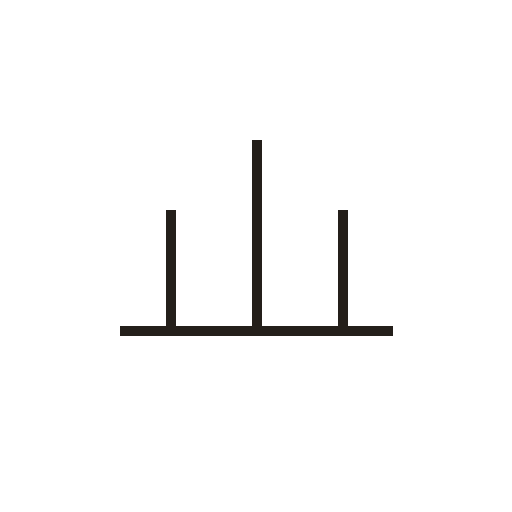

# 山

> 自然现象类 · 商 · 难度 ★

**甲骨形**：
**今字**：山

## 解析
甲骨文的「山」作三峰并列、中峰最高之形，下有一横线表示地平线。
这是典型的象形字——远望群山，取三个山峰的轮廓，中间一座最高。
后来三峰被规范成三个竖笔，底部横线保留，至楷书定为「山」字。
「出」（两座山相叠）、「屮」（草木初生）等字与山形有关。

## 出处
《甲骨文合集》山字诸条（S1）；通行甲骨形见《甲骨文字典》「山」部（S2）。
