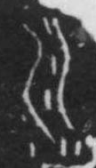

# 川

> 自然现象类 · 商 · 难度 ★

| 甲骨形（示意） | 原拓片（真骨片） |
|:---:|:---:|
|  |  |

**今字**：川

## 解析
甲骨文的「川」是三条竖线（或微弯的流线），像河流的三条水流。
这是河流之象——以水流之形直接为字。卜辞里「川」多指具体河流（如洹、漳）。
后引申为「平地」「通」「流畅」等义，如「川流不息」。

## 出处
《甲骨文合集》川字诸条（S1）；通行甲骨形见《甲骨文字典》「川」部（S2）。

原拓片图：KLOBIP/OBIMD 甲骨文铭文多模态数据集（S6，CC-BY-4.0），主字 yvbokzhzmz。
