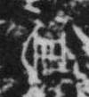

# 明

> 自然现象类 · 商 · 难度 ★

| 甲骨形（示意） | 原拓片（真骨片） |
|:---:|:---:|
|  |  |

**今字**：明

## 解析
甲骨文的「明」是日月之形（两个圆圈），像光明。
这是「明」之象——以日月（光明）之形为字。卜辞中「明」多指光明、明亮（如「王受明」）。
后引申为「光明」「明亮」「明年」等义。

## 出处
《甲骨文合集》明字诸条（S1）；通行甲骨形见《甲骨文字典》「明」部（S2）。

原拓片图：KLOBIP/OBIMD 甲骨文铭文多模态数据集（S6，CC-BY-4.0），主字 3kadgutgs9。
