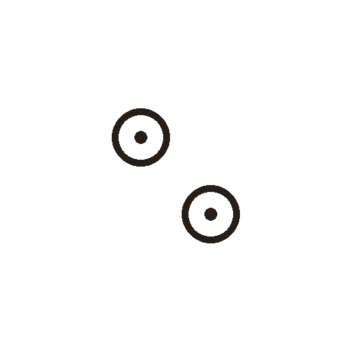

# 星

> 自然现象类 · 商 · 难度 ★★★

**甲骨形**：
**今字**：星

## 解析
甲骨文的「星」是两个小「日」（圆圈中带点）相叠或并列——天上不是只有一个光点
（日），而是许多小光点。以多个小日象形众星。后来两个小日合并，上部加「日」
表示发光，下部省为一横，楷书定为「星」。星、辰、宿等字皆与天上光点相关。
「星」的甲骨形直接点明「众日」之义。

## 出处
《甲骨文合集》星字诸条（S1）；通行甲骨形见《甲骨文字典》「星」部（S2）。
