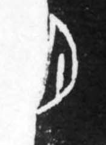

# 月

> 自然现象类 · 商 · 难度 ★

| 甲骨形（示意） | 原拓片（真骨片） |
|:---:|:---:|
|  |  |

**今字**：月

## 解析
甲骨文的「月」作一弯月牙形（上弦之月），中间一点，指月之光明。
与「日」的满圆相对，「月」取弯缺之形，中心一点同样标示发光的部位。
后来月牙被写成一弯加一横的框形，至楷书定为「月」字。有「月」旁的字多与
时间、光明相关（如明、朋、望），朋字即两月相背，本义为贝串，后引申为朋友。

## 出处
《甲骨文合集》月字诸条（S1）；通行甲骨形见《甲骨文字典》「月」部（S2）。

原拓片图：KLOBIP/OBIMD 甲骨文铭文多模态数据集（S6，CC-BY-4.0），主字 0wfbo7ml5k。