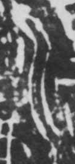

# 水

> 自然现象类 · 商 · 难度 ★★

| 甲骨形（示意） | 原拓片（真骨片） |
|:---:|:---:|
|  |  |

**今字**：水

## 解析
甲骨文的「水」作一条主线（主流），两侧各分出一支（支流），形如水流分支。
这是典型的象形字——以水流的分支形态为字，中央直笔是主流，左右短笔是
旁流。后来主流写成一竖，左右分支写成点与挑，至楷书定为「水」字。
「水」作偏旁时左写为「氵」（三点水），是同一象形的变形。

## 出处
《甲骨文合集》水字诸条（S1）；通行甲骨形见《甲骨文字典》「水」部（S2）。

原拓片图：KLOBIP/OBIMD 甲骨文铭文多模态数据集（S6，CC-BY-4.0），主字 08fa78pdp8。