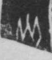

# 火

> 自然现象类 · 商 · 难度 ★★

| 甲骨形（示意） | 原拓片（真骨片） |
|:---:|:---:|
|  |  |

**今字**：火

## 解析
甲骨文的「火」作一竖（火苗主干），两侧各有一点（火星），下部分叉（火焰）。
这是典型的象形字——以火焰升腾之形为字，中央是火苗，两侧星点是迸出的火星。
后来竖笔保留，两点与分叉规范成撇捺，至楷书定为「火」字。
「火」作偏旁时多写作「灬」（四点底），是同一象形的变形。

## 出处
《甲骨文合集》火字诸条（S1）；通行甲骨形见《甲骨文字典》「火」部（S2）。

原拓片图：KLOBIP/OBIMD 甲骨文铭文多模态数据集（S6，CC-BY-4.0），主字 hjfwaxkb60。