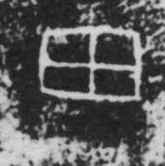

# 田

> 自然现象类 · 商 · 难度 ★

| 甲骨形（示意） | 原拓片（真骨片） |
|:---:|:---:|
|  |  |

**今字**：田

## 解析
甲骨文的「田」是一块方田的形：外框是田界，中一竖一横把田分成四畦。典型的象形
字——以方块田的畦格直接为字。后来田界与畦格固定，楷书定为「田」字。田、由、界、
画等字皆从「田」得义。注意与「天」（天，头上加一点）有别。

## 出处
《甲骨文合集》田字诸条（S1）；通行甲骨形见《甲骨文字典》「田」部（S2）。

原拓片图：KLOBIP/OBIMD 甲骨文铭文多模态数据集（S6，CC-BY-4.0），主字 pzvzykmf5e。
