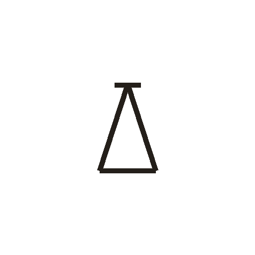
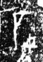

# 石

> 自然现象类 · 商 · 难度 ★

| 甲骨形（示意） | 原拓片（真骨片） |
|:---:|:---:|
|  |  |

**今字**：石

## 解析
甲骨文的「石」是岩石之形（三角形加一横），像石头。
这是「石」之象——以岩石之形为字。卜辞中「石」多指石头、石器（如「王获石」）。
后引申为「石头」「石器」「石壁」等义。

## 出处
《甲骨文合集》石字诸条（S1）；通行甲骨形见《甲骨文字典》「石」部（S2）。

原拓片图：KLOBIP/OBIMD 甲骨文铭文多模态数据集（S6，CC-BY-4.0），主字 xh47ul1r1k。
