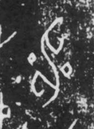

# 雷

> 自然现象类 · 商 · 难度 ★★

| 甲骨形（示意） | 原拓片（真骨片） |
|:---:|:---:|
|  |  |

**今字**：雷

## 解析
甲骨文的「雷」上方是「雨」（天下一排雨点），下方一团是雷声之象（圆圈/田形）。
会意兼象形——雨下而有雷，雷声隆隆。后来雨头保留，雷形简化，加「田」为声旁，
至楷书定为「雷」字。雷、霹、雾等字与雷雨相关。

## 出处
《甲骨文合集》雷字诸条（S1）；通行甲骨形见《甲骨文字典》「雷」部（S2）。

原拓片图：KLOBIP/OBIMD 甲骨文铭文多模态数据集（S6，CC-BY-4.0），主字 ptr3rfuph8。
