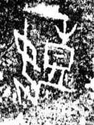

# 黑

> 自然现象类 · 商 · 难度 ★

| 甲骨形（示意） | 原拓片（真骨片） |
|:---:|:---:|
|  |  |

**今字**：黑

## 解析
甲骨文的「黑」是面漆之形（圆圈加一竖、一横），像黑色。
这是「黑」之象——以面漆（黑色）之形为字。卜辞中「黑」多指黑色、黑暗（如「王受黑」）。
后引申为「黑色」「黑暗」「黑幕」等义。

## 出处
《甲骨文合集》黑字诸条（S1）；通行甲骨形见《甲骨文字典》「黑」部（S2）。

原拓片图：KLOBIP/OBIMD 甲骨文铭文多模态数据集（S6，CC-BY-4.0），主字 jpxofd3gmu。
